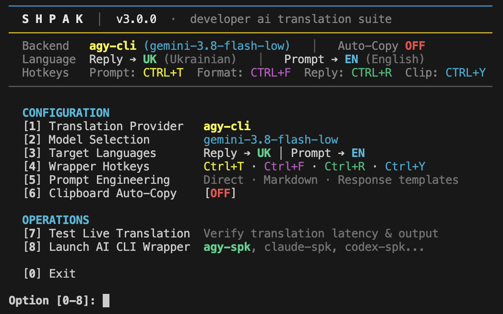

# Shpak (`spk`)

<p align="center">
  <a href="README.md"><b>English</b></a> | <b>Українська</b>
</p>

> **Прозорий термінальний wrapper та перекладач технічних промптів і відповідей для AI-асистентів кодингу (без платних API-ключів).**

<p align="center">
  
</p>

### Що таке Shpak?
**Shpak** — це термінальна утиліта, яка запускає вашого AI-асистента кодингу (наприклад, `agy`, `claude`, `codex` або `cursor-agent`) через віртуальний PTY-термінал. Вона дозволяє писати запити та читати відповіді асистента рідною мовою (українською, польською, німецькою, іспанською тощо), зберігаючи при цьому максимальну технічну точність коду.

### Навіщо це потрібно / Які проблеми вирішує?
1. **Точність генерації коду**: Сучасні AI-моделі набагато краще генерують код, архітектуру та команди bash, коли запит сформульовано точною технічною англійською мовою. Shpak перекладає ваш запит англійською перед тим, як передати його агенту.
2. **Зручність сприйняття**: Читати довгі технічні пояснення, кроки налагодження та розбір помилок значно швидше та легше рідною мовою.
3. **100% захист коду та синтаксису (CodeShield)**: Блоки коду (````...````), інлайн-код (`` `...` ``), шляхи до файлів, прапорці git та математичні формули екрануються AST-плейсхолдерами перед перекладом. Код ніколи не змінюється і не псується.
4. **Без платних API-ключів**: Не потрібні окремі платні ключі OpenAI, Google чи Anthropic. Shpak використовує ваші вже активні підписки розробника (`agy` / `claude`).
5. **Повна прозорість терміналу**: Ви працюєте у звичному терміналі — автодоповнення по Tab, стрілки, історія команд, слеш-команди (`/`) та кольори працюють штатно без лагів та збоїв.

---

## ⚡ Команди CLI та інструменти

Shpak надає ультрашвидкі 3-літерні команди (`spk`) разом із повними аліасами (`shpak`):

| Команда | Повний аліас | Цільовий агент | Опис |
| :--- | :--- | :--- | :--- |
| **`agy-spk`** | `agy-shpak` | **Google Antigravity** (`agy`) | Прозорий PTY-wrapper для Antigravity CLI |
| **`claude-spk`** | `claude-shpak` | **Claude Code CLI** (`claude`) | Прозорий PTY-wrapper для Anthropic Claude Code |
| **`codex-spk`** | `codex-shpak` | **OpenAI Codex CLI** (`codex`) | Прозорий PTY-wrapper для OpenAI Codex CLI |
| **`cursor-spk`** | `cursor-shpak` | **Cursor Agent** (`cursor-agent`) | Прозорий PTY-wrapper для Cursor terminal agent |
| **`spk`** | `shpak` | **Центр керування та налаштувань** | Інтерактивний TUI, детектор агентів, редактор хоткеїв та промптів |

---

## 🚀 Встановлення

### Варіант 1: Швидке встановлення в один рядок (Рекомендовано)
```bash
curl -fsSL https://raw.githubusercontent.com/mo0rych0k/shpak/main/install.sh | bash
```

### Варіант 2: Homebrew (macOS та Linux)
```bash
brew tap mo0rych0k/shpak https://github.com/mo0rych0k/shpak.git
brew install shpak
```
*Або напряму через URL формули:*
```bash
brew install --HEAD https://raw.githubusercontent.com/mo0rych0k/shpak/main/Formula/shpak.rb
```

### Варіант 3: Сучасний менеджер пакетів Python (`uv` або `pipx`)
```bash
uv tool install git+https://github.com/mo0rych0k/shpak.git
# або
pipx install git+https://github.com/mo0rych0k/shpak.git
```

### Варіант 4: Вручну через Git Clone
```bash
git clone https://github.com/mo0rych0k/shpak.git
cd shpak
./install.sh
```

*(Переконайтеся, що `~/.local/bin` додано до вашої змінної `$PATH`)*.

---

## 💻 Сумісність з операційними системами

| Операційна система | Рівень підтримки | Статус тестування | Деталі |
| :--- | :--- | :---: | :--- |
| 🍏 **macOS** | **100% Нативно** | ✔ **Протестовано** | Apple Silicon (M1/M2/M3/M4) та Intel. Нативний BSD PTY та `pbpaste`. |
| 🐧 **Linux** | **100% Нативно** | ⏳ *Не тестовано* | Ubuntu, Debian, Fedora, Arch тощо. Стандартний POSIX PTY. Підтримка Wayland та X11. |
| 🪟 **Windows** | **Повна підтримка через WSL 2** | ⏳ *Не тестовано* | Працює у WSL 2 (відповідає вимогам Antigravity та Claude Code для Windows). |

---

## 🧪 Статус тестування та верифікації

> [!NOTE]
> **Фактичне щоденне тестування**: Наразі Shpak повністю протестовано та перевірено в реальній щоденній роботі **тільки для Google Antigravity (`agy`)** і **тільки на macOS** (Apple Silicon).
>
> Архітектура та код для Linux, Windows (WSL 2), а також для інших AI-асистентів (Claude Code, OpenAI Codex, Cursor Agent) повністю готові та закладені в проєкті, проте ще не проходили тривалих тестів на живих сесіях. Будемо раді вашим тестам, відгукам та Issue/PR на GitHub!

| AI-асистент | macOS | Linux | Windows (WSL 2) | Примітка |
| :--- | :---: | :---: | :---: | :--- |
| **Google Antigravity** (`agy-spk`) | ✔ **Протестовано** | ⏳ Не тестовано | ⏳ Не тестовано | Основний щоденний інструмент |
| **Claude Code CLI** (`claude-spk`) | ⏳ Не тестовано | ⏳ Не тестовано | ⏳ Не тестовано | Реалізовано, очікує живих тестів |
| **OpenAI Codex CLI** (`codex-spk`) | ⏳ Не тестовано | ⏳ Не тестовано | ⏳ Не тестовано | Реалізовано wrapper |
| **Cursor Agent** (`cursor-spk`) | ⏳ Не тестовано | ⏳ Не тестовано | ⏳ Не тестовано | Реалізовано wrapper |

---

## 🌍 Вибір мови при першому запуску

При першому запуску Shpak відкриває інтерактивне вікно налаштування та пропонує обрати цільову мову для відповідей штучного інтелекту:

```text
shpak initial setup
─────────────────────────────────────────────────────────────
Configure target translation languages for AI coding assistants:

[1/2] Target Response Language (AI Agent ➔ You):
  [1] UK  Ukrainian (default)    [2] PL  Polish
  [3] DE  German                 [4] ES  Spanish
  [5] FR  French                 [6] IT  Italian
  [7] JA  Japanese               [8] EN  English
  [C] Custom ISO code (e.g. nl, tr, cs, pt)
```

Змінити мову можна в будь-який момент за допомогою команди `spk config --lang <code>` або через інтерактивне меню `spk`.

---

## 🤖 Автовиявлення AI-асистентів

Дізнайтеся, які AI-помічники кодингу вже встановлені у вашій системі:

```bash
spk agents
# або
spk status
```

Вивід:
```text
Detected AI Coding Assistants:
  • Google Antigravity  [agy-spk   ] : ✔ INSTALLED (/usr/local/bin/agy)
  • Claude Code CLI     [claude-spk] : ✔ INSTALLED (/usr/local/bin/claude)
  • OpenAI Codex CLI    [codex-spk ] : ✖ Not found in PATH
  • Cursor Agent        [cursor-spk] : ✖ Not found in PATH
  • Aider               [spk aider ] : ✖ Not found in PATH
```

---

## 🕹️ Глобальні гарячі клавіші під час сесії

Усі слеш-команди (`/`), автодоповнення по Tab, стрілки клавіатури, історія та ESC-послідовності проходять **на 100% прозоро**:

| Гаряча клавіша | Дія | Опис |
| :--- | :--- | :--- |
| **`Ctrl+T`** | 🌐 **Прямий промпт** | Призупиняє ввід, запитує опис завдання вашою рідною мовою, перекладає технічною англійською та вставляє чистий текст у рядок вводу агента. |
| **`Ctrl+F`** | 📝 **Markdown промпт** | Перекладає та структурує ваш запит у формат інженерного брифу (Ціль, Вимоги, Кроки реалізації, Критерії прийомки). |
| **`Ctrl+R`** | 📜 **Переклад відповіді** | Витягує останню відповідь асистента з логів сесії, перекладає її обраною мовою із захистом **CodeShield**, виводить у термінал і копіює в буфер обміну. |
| **`Ctrl+Y`** | 📋 **Переклад буфера** | Зчитує текст із буфера обміну (наприклад, тікет з Jira або фрагмент з браузера), перекладає технічною англійською та вставляє в активну сесію. |

---

## 💡 Приклади використання

### 1. Запуск Antigravity з обгорткою перекладу
```bash
agy-spk

# Або одразу з початковим завданням рідною мовою:
agy-spk "створи асинхронний HTTP-сервер на FastAPI з авторизацією через JWT"
```

### 2. Запуск Claude Code CLI
```bash
claude-spk

# Із початковим завданням:
claude-spk "зроби рефакторинг обробки помилок у платіжному сервісі"
```

### 3. Запуск Codex CLI
```bash
codex-spk
```

### 4. Інтерактивна демо-пісочниця (без потреби в акаунтах)
Хочете протестувати всі комбінації клавіш прямо зараз без авторизації у сторонніх CLI?
```bash
agy-spk --demo
# або
spk demo
```

### 5. Передача нативних прапорців CLI (наприклад, `--sandbox`, `--continue`, `--model`)
Усі стандартні параметри та прапорці вашого AI-агента передаються напряму через обгортку:
```bash
# Запуск Antigravity в ізольованому сендбоксі:
agy-spk --sandbox

# Запуск у сендбоксі з початковим завданням рідною мовою:
agy-spk --sandbox "створи асинхронний вебсервер"

# Продовження попередньої сесії:
agy-spk --continue
```

---

## 🛠️ Центр керування (`spk`)

Відкрийте єдину інтерактивну консоль налаштувань у будь-який момент:
```bash
spk
```

<p align="center">
  
</p>

TUI надає повну інформацію про середовище перекладу в реальному часі без необхідності вручну редагувати конфігураційні файли:

* **Статусний заголовок**: Відображає поточний бекенд перекладу (`agy-cli` / `claude-cli`), активну модель (`gemini-3.8-flash-low`, `haiku` тощо), стан автоперекладу промптів (`ON`/`OFF`), мови вводу та виводу, порт проксі та зареєстровані гарячі клавіші.
* **Меню конфігурації `[1-6]`**:
  * `[1]` Перемикання активного агента між Google Antigravity та Claude Code.
  * `[2]` Вибір профілю моделі перекладу (швидкий відгук проти глибокого міркування).
  * `[3]` Зміна мови перекладу відповідей (`UK`, `PL`, `DE`, `ES`, `FR`, `IT`, `JA`, `EN` або довільний ISO-код).
  * `[4]` Зміна мови перекладу вхідних промптів.
  * `[5]` Налаштування глобальних гарячих клавіш (`Ctrl+T`, `Ctrl+F`, `Ctrl+R`, `Ctrl+Y`).
  * `[6]` Точне налаштування системних правил промпт-інжинірингу для технічних перекладів.
* **Операції та агенти `[7-0]`**:
  * `[7]` Прямий запуск налаштованого AI-асистента з прозорим перекладом.
  * `[8]` Відкриття **Demo Sandbox** для експериментів з перекладом без входу в сторонні CLI.
  * `[9]` Запуск діагностики для перевірки наявності встановлених CLI-агентів у вашому `$PATH`.
  * `[U]` Перевірка та завантаження оновлень до останньої версії Shpak.
  * `[0]` Безпечний вихід.

---

## 🛡️ Технологія CodeShield

Переклад відповідей надійно захищений рушієм **CodeShield**:
* Блоки коду (````...````) та інлайн-код (`` `...` ``) екрануються AST-плейсхолдерами і ніколи не змінюються.
* Шляхи до файлів, ідентифікатори, імена класів, назви змінних і прапорці git залишаються незмінними.
* Математичні формули в KaTeX, виділені блоки LaTeX і матриці ASCII/Unicode зберігають точну візуальну структуру.
* Повторні запити на переклад повертаються за 0.01 сек завдяки вбудованому кешу.

---

## 🗑️ Видалення (Uninstallation)

Щоб повністю видалити Shpak із системи (разом із бінарними файлами, конфігурацією та кешем для 100% чистого скидання):

### Швидка команда
```bash
curl -fsSL https://raw.githubusercontent.com/mo0rych0k/shpak/main/uninstall.sh | bash
```

### Або вручну
```bash
# 1. Видалення сімлінків CLI
rm -f ~/.local/bin/spk ~/.local/bin/shpak ~/.local/bin/*-spk ~/.local/bin/*-shpak

# 2. Видалення налаштувань та кешу (скидає онбординг до стану "з нуля")
rm -rf ~/.config/shpak ~/.config/llm-translate ~/.cache/shpak

# 3. Видалення клонованого репозиторію (якщо встановлювався через curl)
rm -rf ~/.shpak
```

---

## 📄 Ліцензія

[Ліцензія MIT](LICENSE). Створено з ❤️ в Україні.
